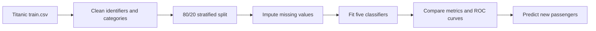

# Titanic Survival Prediction

### Compare five classification models in an interactive R/Shiny app

[](https://www.r-project.org/)
[](https://shiny.posit.co/)
[](https://www.tidymodels.org/)

This project turns a Titanic classification workflow into an interactive Shiny application. Users can inspect the data, fit five models, compare accuracy and ROC AUC, review confusion matrices, and generate predictions for new passengers.

The primary implementation is **R/Shiny**. Supplemental Python and Streamlit files are included for comparison and reproducibility, but the app users should start with is `app.R`.

## Contents

- [What the app does](#what-the-app-does)
- [Quick start](#quick-start)
- [Modeling workflow](#modeling-workflow)
- [Project structure](#project-structure)
- [Limitations and known issues](#limitations-and-known-issues)
- [Contribution](#contribution)
- [Support](#support)
- [License](#license)

## What the app does

- Explores training data and missing values
- Fits logistic regression, k-nearest neighbors, decision tree, random forest, and naive Bayes models
- Compares accuracy, precision, recall, F1, and ROC AUC
- Displays ROC curves and confusion matrices
- Predicts survival for a new passenger profile
- Exports test-data predictions as a CSV file

## Quick start

### Prerequisites

- R 4.2 or newer
- RStudio recommended
- The packages listed below

Install the R dependencies:

```r
install.packages(c("shiny", "shinydashboard", "tidyverse", "tidymodels",
                   "janitor", "DT", "ranger", "C50", "kknn", "klaR"))
```

Run the primary app from RStudio:

```r
shiny::runApp()
```

Click **Fit all models** in the Models tab before opening comparisons or downloading predictions.

## Modeling workflow



The workflow uses tidymodels recipes, median/mode imputation, one-hot encoding where needed, and consistent validation metrics.

## Project structure

```text
stat652-titanic-shiny/
├── app.R                       # Primary R/Shiny application
├── train.csv, test.csv         # Titanic training and test data
├── report.qmd                  # Quarto project report
├── app.py                      # Supplemental Streamlit conversion
├── titanic_analysis.py         # Supplemental Python analysis
├── titanic_analysis_python.py  # Supplemental Python conversion
└── requirements.txt             # Python supplemental dependencies
```

## Limitations and known issues

- Titanic is a historical benchmark dataset and should not be treated as a real-world deployment scenario.
- Model performance depends on the fixed dataset and validation split.
- The app requires the R packages above; package-engine changes may affect results.
- The Python files are supplemental and are not the primary project implementation.

## Contribution

Open an issue with a reproducible example, keep the primary interface in `app.R`, and describe any change to model definitions or evaluation metrics in a pull request.

## Support

Use GitHub Issues or connect with [Myungje Kim on LinkedIn](https://www.linkedin.com/in/evan-kim-257857249/).

## License

No open-source license has been specified yet. Contact the repository owner before redistributing or adapting the code.
